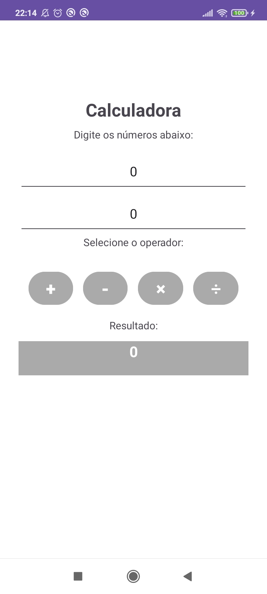
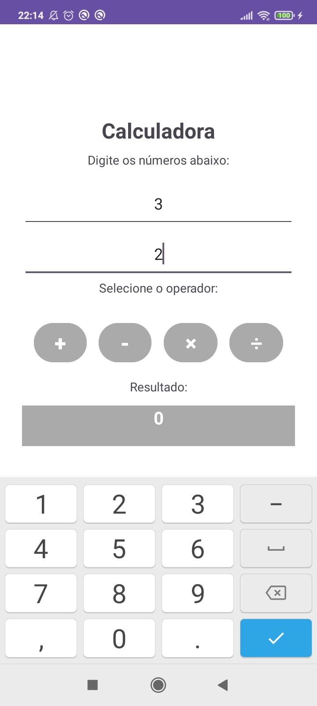
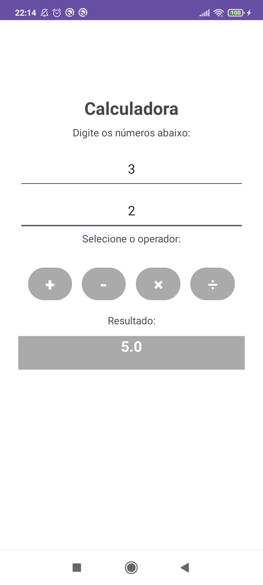

# Simple Android Calculator


A native Android application implementing a basic calculator with a clean and straightforward user interface. Developed in Java using Android Studio, the app allows users to perform standard arithmetic operations (addition, subtraction, multiplication, and division) through interactive UI components.

## 📱 Screenshots

<p align="center">
  
  
  
</p>

## 📌 Features

* **Core Arithmetic Operations:** Performs addition, subtraction, multiplication, and division in real time.
* **Native Android UI:** Built with ConstraintLayout and LinearLayout, utilizing standard EditText inputs, action Buttons, and a dynamic TextView for result display.
* **Responsive Numeric Input:** Configured numeric keyboard integration for smooth user input.

## 🎓 Academic Context

Developed as the final project for the **Mobile Device Programming** course in the **Systems Analysis and Development** associate degree program.

The project objective was to build a functional mobile application in Android Studio focusing on basic Android component lifecycle, XML layout management, and View event listeners.

## 🛠️ Tech Stack & Requirements

* **Language:** Java 8
* **Platform:** Android (Min SDK 24 / Target SDK 33)
* **IDE:** Android Studio
* **Build System:** Gradle

## 🚀 How to Run Locally

1. Clone the repository:
```bash
git clone [https://github.com/narahsouza/android-calculator.git](https://github.com/narahsouza/android-calculator.git)
```
2. Open the project folder in Android Studio.
3. Allow Gradle to sync dependencies.
4. Select an Android Emulator (AVD) or connect a physical Android device with USB debugging enabled.
5. Click Run (Shift + F10) to build and launch the application.
